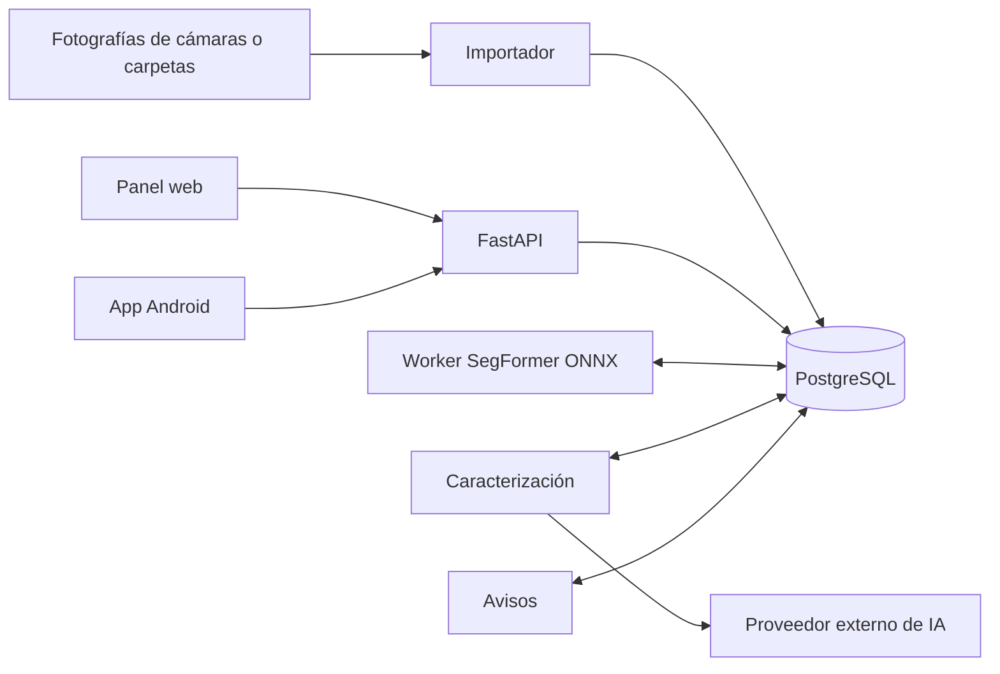

# StockEye

Prototipo académico de visión artificial para estimar el **vacío visible en góndolas de supermercado** y gestionar su reposición mediante tickets, responsables y evidencia. Combina análisis de fotografías, un panel web para administración y supervisión, y una aplicación Android para el reponedor.

Proyecto de título de Duoc UC, sede Padre Alonso Ovalle, desarrollado en el contexto del caso de supermercados Walmart Chile.

**Equipo:** Jesús González · Claudio Galiano · Ignacio Ruz Aguilar.

## Organización del proyecto

Este repositorio reúne la documentación académica, las evidencias por etapa y la exploración inicial del modelo. La copia local también contiene el sistema integrado en `desarrollo/`.

| Ruta | Contenido |
|---|---|
| `Fase 1/` | Definición del proyecto y evidencias grupales e individuales. |
| `Raíz_ FINAL FASE 1/` | Entrega de Fase 1: requisitos, casos de uso, diagramas y notebook inicial. |
| `Fase 2/` | Seguimiento y evidencias del desarrollo. |
| `FINAL FASE 2/` | Manuales, documentación técnica, base de datos, APK y videos de funcionamiento. |
| `FINAL FASE 3/` | Presentación final y diarios de reflexión de los tres integrantes. |
| `desarrollo/` | Copia local del backend, base de datos, web, Android y configuración Docker. |
| `StockEye_Demo.ipynb` | Notebook histórico de exploración y entrenamiento; conserva sus propios requisitos y resultados. |

### Repositorio de la aplicación

El código integrado se mantiene en **[bakend_StockEye](https://github.com/portfafolioJesus/bakend_StockEye)**. `desarrollo/` conserva su propio directorio `.git`; no está configurado como submódulo de este repositorio. Los archivos `front.tsx`, `back.tsx` y `css.css` que ya se versionaban allí son restos de la propuesta inicial, no los puntos de entrada del sistema actual.

Clonar este repositorio de entregables no garantiza obtener las carpetas que aún estén sin seguimiento en una copia local. Para descargar el sistema por separado, abre una terminal **fuera de `proyecto-de-titulo`** y utiliza una carpeta nueva:

```powershell
git clone https://github.com/portfafolioJesus/bakend_StockEye.git stockeye-sistema
Set-Location .\stockeye-sistema
```

Para trabajar con la copia integrada que ya existe en esta máquina, entra en `desarrollo/` desde la raíz de `proyecto-de-titulo`.

## Sistema implementado

| Componente | Ubicación en `desarrollo/` | Función |
|---|---|---|
| API FastAPI | `backend/stockeye/api/` | Autenticación, imágenes, tickets, reportes y operaciones por rol. |
| Inferencia local | `backend/stockeye/inferencia/` | Segmentación con SegFormer exportado a ONNX y cálculo del vacío observado. |
| Importador y caracterización | `backend/stockeye/importador/`, `backend/stockeye/clasificacion/` | Registro de fotos por recinto, clasificación externa y revisión manual. |
| Base de datos PostgreSQL 16 | `db/migraciones/` | Esquema, migraciones, reglas de asignación, tareas e historial. |
| Panel web | `web/` | React, TypeScript y Vite para administrador y supervisor. |
| Aplicación Android | `StockEye-app-movil/app-movil/` | Kotlin y Compose para reportar fotografías y gestionar tareas. |
| Capturador | `db/capturador/` | Capturas periódicas desde cámaras configuradas. |
| Despliegue | `docker-compose.yml`, `docker-compose.recintos.yml` | Servicios del servidor y alternativa de workers por recinto. |

La web y Android consumen la misma API. Los servicios separan recepción, inferencia, caracterización y avisos, con PostgreSQL compartido para datos y coordinación de tareas.



El worker local calcula el porcentaje de vacío. La IA externa caracteriza productos visibles y categorías; su descripción no prueba qué producto falta en un hueco.

## Flujo de operación

1. **Entrada automática:** cámaras o carpetas aportan fotografías. El importador registra la captura y el worker ejecuta el análisis.
2. **Regla de vacío:** si el porcentaje supera el umbral del recinto, se abre un ticket o se incorpora evidencia de seguimiento según la góndola identificada. El ejemplo configurado es 5 %; la comparación es estricta `>`, no `>=`.
3. **Asignación:** un ticket nuevo se asigna al reponedor activo elegible del mismo recinto con menor carga activa. El supervisor puede asignarlo o reasignarlo; sin candidato, queda abierto.
4. **Reporte móvil:** el reponedor selecciona la góndola, toma o elige una foto, revisa el resultado y confirma el reporte. Esta vía admite excepciones bajo el umbral.
5. **Atención y cierre:** se conservan comentarios, evidencias e historial. Un cierre con evidencia analizada que no supera el umbral se distingue del cierre excepcional sin verificación, que exige un comentario de al menos cinco caracteres.

Administrador y supervisor utilizan la web; el reponedor utiliza Android. El APK requiere conexión con el backend y no ejecuta el modelo en el teléfono. Los avisos internos y el envío push son capacidades diferentes; Firebase/Web Push requieren configuración y permisos.

Si se agota la cuota de caracterización externa, se conserva la cola y se permite clasificación manual. El análisis local de vacío puede continuar mientras estén disponibles sus servicios y la base de datos.

## Preparar el entorno de desarrollo

Requisitos: Git, Docker con Docker Compose y los artefactos del modelo. Para Android se necesita Android Studio y una combinación compatible de JDK, Gradle y Android Gradle Plugin, según su documentación.

Desde la carpeta que contiene `docker-compose.yml` —`desarrollo/` en esta copia—:

```powershell
if (-not (Test-Path -LiteralPath .env)) {
    Copy-Item -LiteralPath .env.example -Destination .env
}
```

Completa las credenciales y opciones de `.env` de manera privada. Este comando conserva un `.env` existente. Los archivos reales de configuración y secretos se excluyen de Git; `.env.example` queda disponible como plantilla.

Antes de iniciar el worker, coloca en `backend/modelos/` el manifiesto `segformer-mit-b1-v1.json` y su archivo `segformer-mit-b1-v1.onnx`, o configura `MODELOS_HOST` para usar otra ubicación. Los pesos binarios se distribuyen por separado y el manifiesto debe corresponder al archivo.

```powershell
docker compose up -d --build
docker compose exec api python -m stockeye.cli modelo registrar /modelos/segformer-mit-b1-v1.json --activar
```

El primer comando crea o actualiza contenedores y volúmenes; el migrador aplica el esquema. El segundo registra y activa el artefacto indicado. Son pasos de instalación: no fueron ejecutados durante esta actualización del README.

Los datos de demostración son opcionales y modifican la base de datos del entorno:

```powershell
docker compose --profile demo run --rm seed
```

| Acceso predeterminado | Dirección |
|---|---|
| Panel web | `http://localhost:8080` |
| Documentación de la API | `http://localhost:8080/api/docs` |
| PostgreSQL desde el host | `127.0.0.1:5433` |
| Backend desde el emulador Android | `http://10.0.2.2:8080/` |

Los puertos pueden cambiar mediante `.env`. Para un teléfono real, configura la dirección alcanzable del servidor desde la aplicación. Revisa red, permisos y configuración de transporte antes de probar fuera del emulador.

Con el servidor preparado, las fotos sin clasificar se reciben en `entradas/R01/por_clasificar/` y `entradas/R02/por_clasificar/`, relativas a la carpeta de desarrollo. La web permite revisar imágenes pendientes y corregir categorías.

## Documentación y evidencias

Manuales del repositorio de la aplicación:

- [Instalación y operación](https://github.com/portfafolioJesus/bakend_StockEye/blob/main/docs/MANUAL_INSTALACION.md).
- [Arquitectura](https://github.com/portfafolioJesus/bakend_StockEye/blob/main/docs/ARQUITECTURA.md).
- [API](https://github.com/portfafolioJesus/bakend_StockEye/blob/main/docs/API.md).
- [Aplicación Android](https://github.com/portfafolioJesus/bakend_StockEye/blob/main/StockEye-app-movil/app-movil/README.md).

En la copia local de los entregables:

- APK: `FINAL FASE 2/evidencia de proyecto/Evidencias de sistema/Aplicación/APK sistema/stockeye-debug.apk`.
- Tutorial web: `FINAL FASE 2/evidencia de proyecto/Evidencias de sistema/StockEye_video_admin-supervisor.zip`.
- Tutorial móvil: `FINAL FASE 2/evidencia de proyecto/Evidencias de sistema/StockEye_WhatsApp_con_audio.mp4`.
- Presentación final: `FINAL FASE 3/Evidencias Grupales/Presentación Final del proyecto.pptx`.
- Manuales de entrenamiento, aplicación y base de datos: carpetas `ANEXOS/` y `Guia implementacion/` de la entrega de Fase 2.

Estos archivos se publican cuando se incorporan expresamente al historial del repositorio; su presencia local no equivale a un commit. Los documentos de etapas anteriores pueden describir otras tecnologías o reglas y deben contrastarse con el código integrado.

## Notebook histórico y alcance de los resultados

`StockEye_Demo.ipynb` conserva una exploración anterior basada en Colab y sus insumos externos. El repositorio contiene también otras versiones del notebook en las entregas. Sus métricas pertenecen a cada experimento y no deben atribuirse automáticamente al SegFormer ONNX del backend.

Antes de ejecutar un notebook, revisa sus rutas de datos, dependencias, pesos y celdas de restauración o entrenamiento: algunas pueden iniciar procesos prolongados. El backend actual no necesita ejecutar ese notebook para atender peticiones.

El porcentaje representa evidencia visible segmentada, no inventario físico, volumen real ni unidades exactas de producto. Los videos demuestran funcionalidades; no acreditan por sí solos precisión general, ahorro económico o validación productiva. La calidad del modelo, los permisos de los datos y las condiciones de despliegue requieren evaluación propia antes de uso real.

## Archivos locales y control de versiones

El `.gitignore` raíz excluye entornos virtuales, dependencias, compilaciones, cachés, configuraciones privadas, datos operativos y pesos de modelos. Conserva las plantillas de configuración y permite documentos, diagramas, notebooks, APK de entrega y los videos o ZIP que sí corresponden al portafolio.

El paquete `stockeye_v6-20261116T000048Z-1-001.zip`, de aproximadamente 1,40 GB, se conserva localmente y se excluye mediante su ruta exacta. GitHub limita a 100 MiB cada archivo en Git normal; el material pesado debe distribuirse por separado con su ubicación y permisos documentados. `.gitignore` no impone un límite por tamaño ni retira archivos que ya estén en el historial.

Antes de preparar un commit, revisa `git status` y selecciona los archivos necesarios. Para la aplicación dentro de `desarrollo/`, comprueba también su repositorio independiente; un commit en el padre no registra automáticamente los cambios del hijo.
